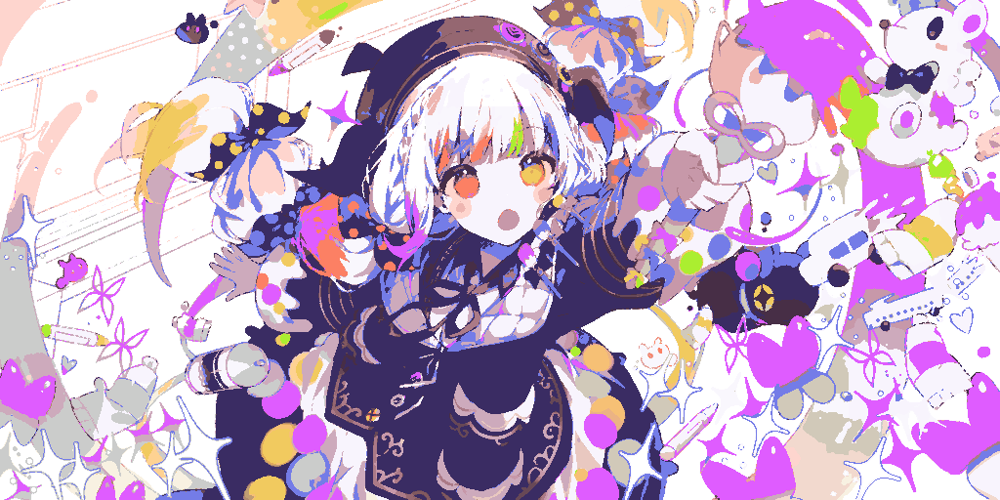
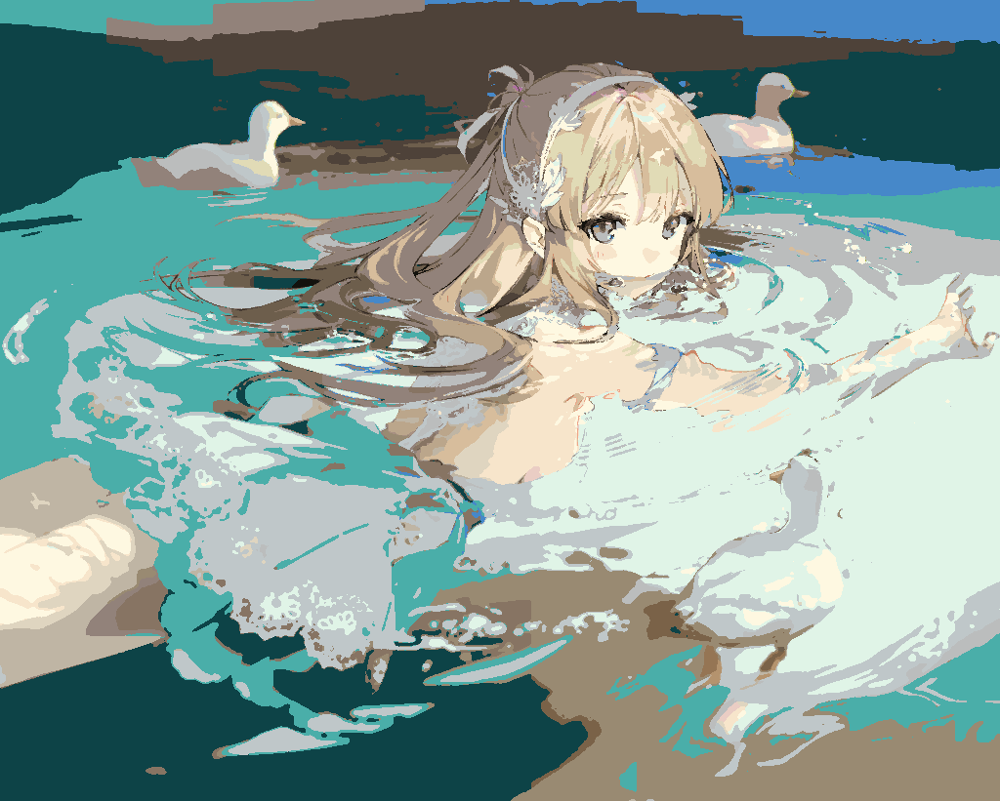
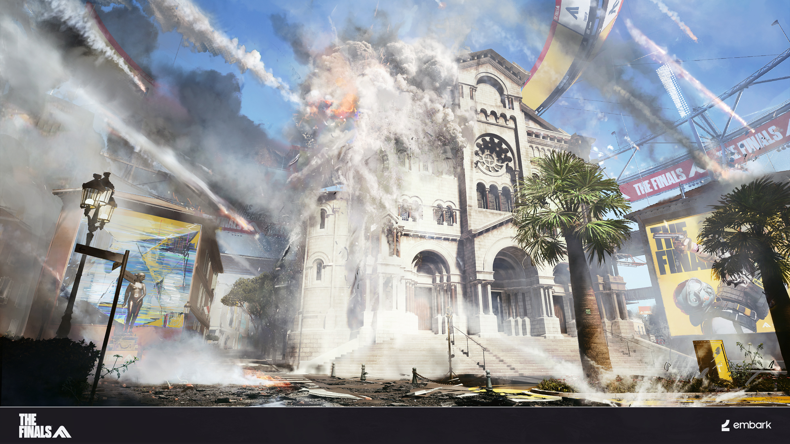
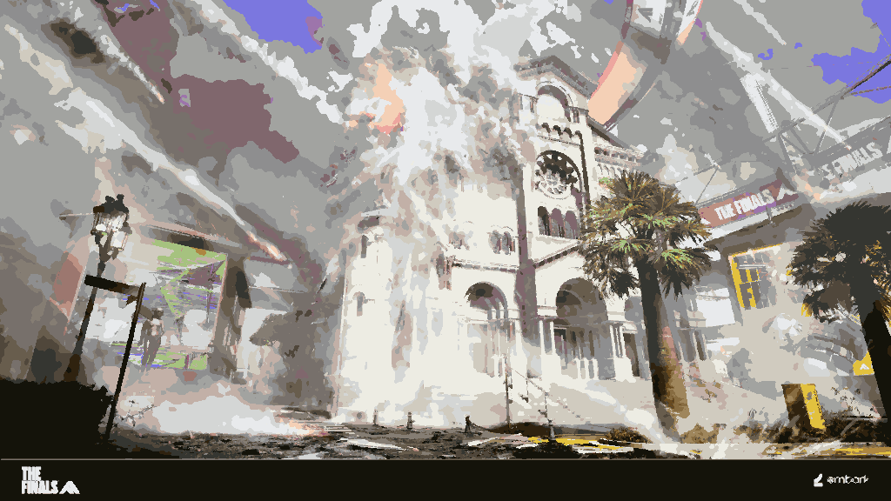

# vue-painterly-image

图片简化函数库，无运行时依赖。`simplifyImage()` 在浏览器中使用，支持 Blob 或 File；最长边缩小至不超过 1024 像素，保持比例。运行 `npm run build` 使用 `tsc` 生成 JS 和类型声明。

## 图片示例

以下使用三张示例图片(仅作展示作用，侵权删除)，分别调用 `simplifyImage(blob, 'comparison', { colors: 'auto' })`，其余采用默认参数。左侧为原图，右侧为返回的简化 `png`，两侧统一按 480px 宽度等比展示；`plainPng` 是同一简化画面的浏览器 RGBA PNG 编码。

| 输入图片 | 输出尺寸 | 色数 | png | plainPng |
| --- | --- | --- | --- | --- |
| Still_110_001.png | 1024 × 512 | 30 | 86.1 KiB | 186.2 KiB |
| illust_133646178_20250812_190458.jpg | 1024 × 821 | 30 | 69.0 KiB | 165.9 KiB |
| THE_FINALS_Concept_006_TakeCover_2880x1620.jpg | 1024 × 576 | 29 | 100.7 KiB | 220.4 KiB |

**魔法少女的魔女裁判游戏CG**

| 原图 | 简化 PNG |
| --- | --- |
|  |  |

**PID133646178**

| 原图 | 简化 PNG |
| --- | --- |
|  |  |

**THE FINALS艺术图**

| 原图 | 简化 PNG |
| --- | --- |
|  |  |

## 调用与参数

```ts
import { simplifyImage, type AnaOptions } from 'vue-painterly-image'

const blob = await (await fetch('/image.png')).blob()

// 所有参数均可省略；下面列出当前默认值。
const ana: AnaOptions = {
  colors: 'auto',                // 自动选色，最多 30 色；也可传 1~256 的颜色数上限
  centerWeight: 4,              // 画面中心奖励，0 关闭
  specialWeight: 4,             // 鲜艳度和特殊色相奖励，0 关闭
  anchorMinPercent: 2,          // 黑白锚点候选的最小有效面积百分比
  mergeRange: 8,                // 近色归并范围，越大越容易合并
  mergeSpatialRadius: 0.15,     // 归并距离占最长边的比例，0 关闭空间限制
  mergeLightnessWeight: 3,      // 归并时明度相似奖励，0~4
  mappingPositionWeight: 3,     // 映射时空间邻近奖励，0~4
  mappingSpecialWeight: 0.5,    // 映射时同类特殊色奖励，0~4
  mappingNeutralPenalty: 0.45,  // 映射到纯黑白时的代价增幅，0~4
  contourSteps: 1,              // 边界平滑次数，0~16，0 关闭
  connectedPower: 2,            // 连通面积指数，1~3，越大越偏向连续色块
  scatteredFloor: 0.5,          // 零散颜色评分保底，0~1
  areaPower: 0.72,              // 面积指数，0.3~1，越小越照顾小色块
  accentSlots: 5,               // 显著色优先名额，0 关闭
  accentMinArea: 3,             // 显著色最小连通面积，按透明度加权
  skinSlots: 2,                 // 肤色独立优先名额，0 关闭
  skinMinArea: 9,               // 肤色最小连通面积，按透明度加权
  edgeWeight: 4,                // 边界对比奖励，0 关闭
  lineProtection: 1,            // 细线保护强度，0~1，0 关闭
  lineWindow: 7,                // 细线检测窗口，归一化为 3~15 内的奇数
  lineContrast: 0.075,          // 细线与周围颜色的最小 OKLab 色差
  lineMaxDensity: 0.38,         // 细线在局部窗口内的最大面积比例，0~1
  edgeSigma: 2                  // 平滑颜色引导尺度，越小越不容易跨越颜色边界
}

const result = await simplifyImage(blob, 'json', ana)
```

`simplifyImage(blob, format?, ana?)` 返回 Promise；`format` 默认 `'png'`。下面分别展示四种格式，每次调用都会重新分析图片。JSON 示例以一张 2×1 的红色、半透明蓝色图片示意。

## 返回格式

### png：PNG 图片

```ts
const png = await simplifyImage(blob, 'png', ana)
// 返回 Blob，type 为 "image/png"，size 为实际文件字节数。
```

比较索引 PNG 和浏览器 RGBA PNG 编码，返回体积较小者，不保证小于原始图片。

### json：像素 JSON

```ts
const json = await simplifyImage(blob, 'json', ana)
```

```json
{
  "width": 2,
  "height": 1,
  "palette": [[255, 0, 0], [0, 0, 255]],
  "labels": [0, 1],
  "alpha": [255, 128]
}
```

`palette` 是 RGB 调色板，`labels` 按行记录每个像素的颜色编号，长度为宽 × 高。`alpha` 为逐像素透明度，全部不透明时省略。

### regions：区域 JSON

```ts
const regions = await simplifyImage(blob, 'regions', ana)
```

```json
{
  "version": 1,
  "width": 2,
  "height": 1,
  "colors": [
    { "color": [255, 0, 0], "regions": [{ "bounds": [0, 0, 1, 1] }] },
    { "color": [0, 0, 255], "regions": [{ "bounds": [1, 0, 1, 1], "alpha": 128 }] }
  ]
}
```

按颜色分组记录区域，`bounds` 为 `[x, y, width, height]`。非矩形区域额外记录 `runs: [[起始位置, 长度], ...]`，位置基于包围盒内的行优先索引，可跨行；省略时填满矩形。区域 `alpha` 省略时为 255，完全透明区域不记录。

两种 JSON 可以还原相同的简化画面；连续同色区域多时，区域 JSON 可能更小，碎片多时可能更大。

### comparison：两种 PNG 编码的对比结果

```ts
const comparison = await simplifyImage(blob, 'comparison', ana)
```

返回示意：

```text
{
  png: Blob { type: "image/png", size: … },
  plainPng: Blob { type: "image/png", size: … },
  colorCount: 2,
  width: 2,
  height: 1
}
```

`png` 是选出的较小 PNG；`plainPng` 是同一简化结果的浏览器 RGBA PNG，并非原图。

## 辅助函数

| 导出 | 用途 |
| --- | --- |
| `analyzePixels(rgba, width, height, ana?)` | 同步分析已解码的 `Uint8ClampedArray` RGBA，返回调色板、像素标签和区域；不解码、不缩放，可在 Node.js 使用 |
| `toRegionJSON(analysis)` | 将分析结果转换为上述区域 JSON，不重新简化 |
| `regionJSONToPixels(regions)` | 将区域 JSON 还原为 RGBA `Uint8ClampedArray` |
| `getLineProtectionMask(rgba, analysis, ana?)` | 调试细线检测，返回逐像素的 0/1 掩码；仅使用 `lineWindow`、`lineContrast`、`lineMaxDensity` 参数 |
| `defaultAnalysisOptions` | 读取上述默认分析参数 |
